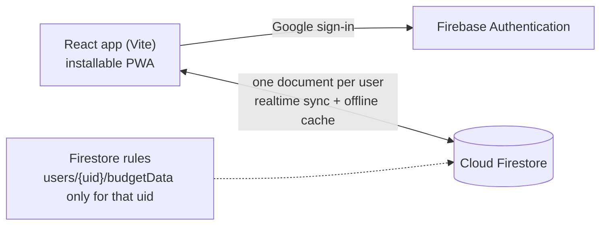

# Budget Ledger

A personal monthly budget ledger as an installable web app. Track income and expenses by
category, see where the money goes, carry balances forward from month to month, and keep
the same data in sync across your phone and computer.

## Features

- **Monthly ledger** of income and expense entries, grouped into categories (Housing,
  Transport, Daily Living, Savings and so on), with month-by-month navigation
- **Planned vs actual** amounts per category, and savings goals with targets
- **Rollover**: optionally carry the balance from one month to the next, and reset it
  each year
- **Charts**: spending by group (pie) and trends over time (bar), plus a running balance
- **Search, copy and archive** categories without losing past months
- **CSV export** of your data
- **Sign in with Google**; every user's data is private to their own account
- **Works offline**: edits are kept on the device and sync when the connection returns
- **Installable** on Android, iOS and desktop (PWA)

## How it works



- The whole ledger for a user lives in **one Firestore document**, read with a realtime
  listener (`src/useCloudDoc.js`). Writes are debounced, so typing an amount does not
  send a write per keystroke, and echoes of the app's own writes are ignored.
- **Security rules** (`firestore.rules`) allow a signed-in user to read and write only
  their own `users/{uid}/budgetData` documents.
- Firestore's persistent local cache makes the app usable offline and queues writes.

## Stack

React 18, Vite, Recharts, Firebase (Auth, Firestore, Hosting), vite-plugin-pwa, lucide-react.

## Run it

```bash
cp .env.example .env.local   # then fill in your own Firebase web app settings
npm install
npm run dev
```

[`SETUP.md`](SETUP.md) walks through creating the Firebase project, deploying, and
installing the app on your devices. A Firebase web API key only identifies the project and
is public by design; access is controlled by sign-in and the Firestore rules.

```bash
npm run build && firebase deploy
```

New accounts start with the default categories at zero amounts; set your own in the app.

## Project layout

| Path | What it is |
| --- | --- |
| `src/BudgetLedger.jsx` | The ledger UI and budget logic |
| `src/useCloudDoc.js` | Realtime sync of one Firestore document per user |
| `src/firebase.js` | Firebase setup from environment variables |
| `src/App.jsx` | Sign-in screen, config check and app shell |
| `firestore.rules` | Per-user access rules |
| `vite.config.js` | Build and PWA manifest |

There is no automated test suite yet.
